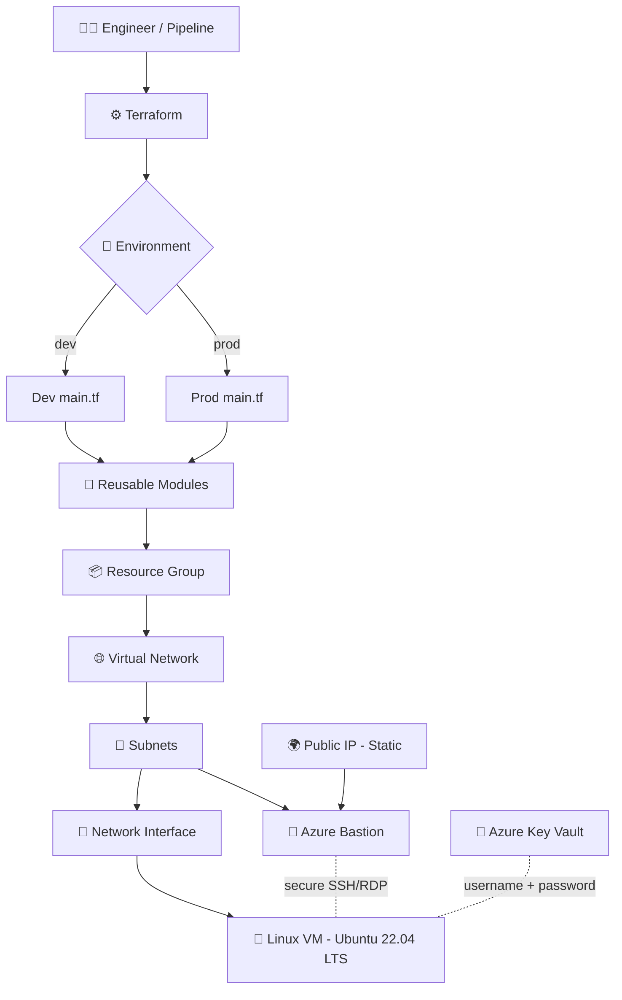
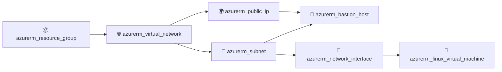
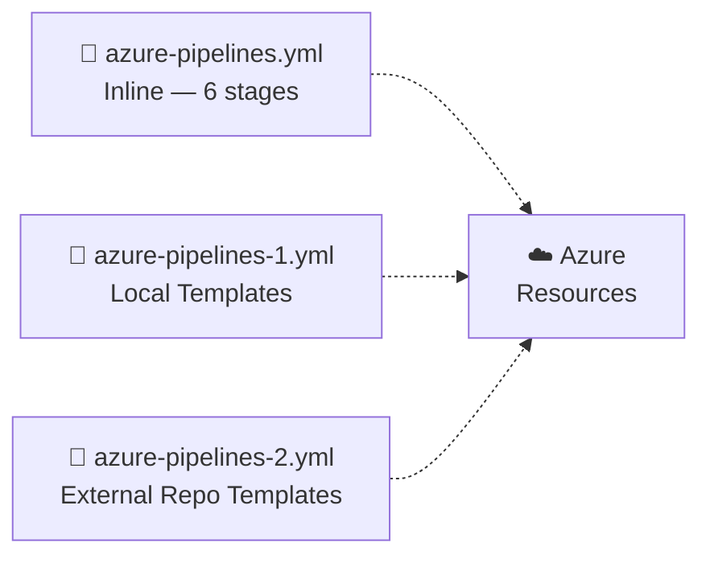
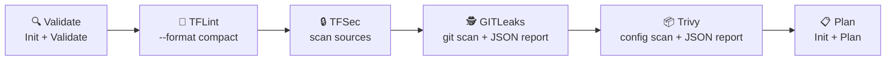
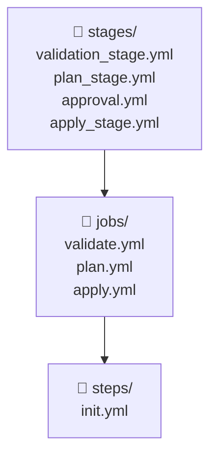
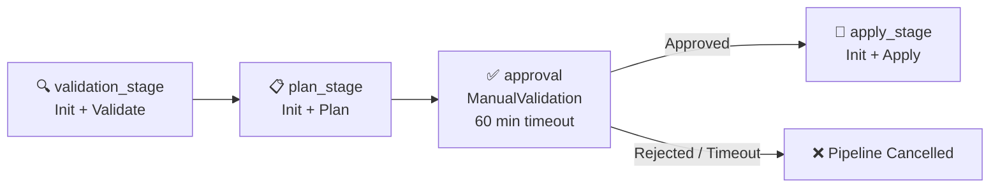

<div align="center">


<a href="https://git.io/typing-svg">
  
</a>

<br/>


</div>

---

## ✨ About the Project

**terraform-azure-modular-infra** is a production-style Terraform project that provisions a complete Azure landing-zone using **reusable modules**, **separate `dev` / `prod` environments**, and **Azure DevOps CI/CD pipelines** with fully reusable YAML templates.

Every Azure resource (Resource Group, VNet, Subnet, Public IP, NIC, Bastion, Linux VM) is an independent module. Environments call those modules with different `terraform.tfvars` values — same code, different config. The pipeline library provides plug-and-play stage, job, and step templates covering the complete `init → validate → plan → approve → apply` lifecycle.

---

## 🌟 Highlights

| | Feature | Detail |
|---|---|---|
| 🧩 | **Reusable Modules** | One module per resource type; each uses `for_each` for multi-instance support |
| 🌍 | **Environment Separation** | `dev` and `prod` folders share the same modules, differ only in `terraform.tfvars` |
| 🔐 | **Secret Management** | VM credentials fetched from **Azure Key Vault** at runtime — never hardcoded |
| 🛡️ | **Secure VM Access** | **Azure Bastion** provides browser-based SSH / RDP; VM has no public IP |
| 🔁 | **Reusable YAML Templates** | `stages/`, `jobs/`, `steps/` templates composable across multiple pipelines |
| ✅ | **Manual Approval Gate** | `approval.yml` stage halts the pipeline for human review before `apply` |
| 🔍 | **Security Scanning** | TFLint · TFSec · Gitleaks · Trivy baked in as optional pipeline stages |
| 📈 | **Plan before Apply** | Every change is reviewed with `terraform plan` before deployment |

---

## 🧱 Architecture



---

## 📂 Repository Structure

```text
📦 terraform-azure-modular-infra
│
├── 📁 Environment
│   ├── 📁 dev
│   │   ├── 📄 main.tf            ← calls all 7 modules with depends_on chain
│   │   ├── 📄 provider.tf        ← azurerm provider v5.10.0
│   │   ├── 📄 terraform.tfvars   ← dev values: dev-rg1/2, dev-vnet1/2, dev-vm1 …
│   │   └── 📄 variable.tf        ← 7 vars: rgs, vnet, subnet, nic, pip, bastion, vm
│   └── 📁 prod
│       ├── 📄 main.tf            ← identical module calls, prod-prefixed names
│       ├── 📄 provider.tf        ← azurerm provider v5.10.0
│       ├── 📄 terraform.tfvars   ← prod values: prod-rg1/2, prod-vnet1/2, prod-vm1 …
│       └── 📄 variable.tf        ← same 7 variable declarations
│
├── 📁 Module
│   ├── 📁 Azurerm_Resource_Group      ← azurerm_resource_group  (for_each on rgs)
│   │   ├── 📄 main.tf
│   │   └── 📄 variable.tf
│   ├── 📁 Azurerm_Virtual_Network     ← azurerm_virtual_network (for_each on vnet)
│   │   ├── 📄 main.tf
│   │   └── 📄 variable.tf
│   ├── 📁 Azurerm_Subnet              ← azurerm_subnet          (for_each on subnet)
│   │   ├── 📄 main.tf
│   │   └── 📄 variable.tf
│   ├── 📁 Azurerm_Pip                 ← azurerm_public_ip Static (for_each on pip)
│   │   ├── 📄 main.tf
│   │   └── 📄 variable.tf
│   ├── 📁 Azurerm_Network_interface   ← data subnet + azurerm_network_interface Dynamic
│   │   ├── 📄 main.tf
│   │   └── 📄 variable.tf
│   ├── 📁 Azurerm_Bastion             ← data subnet+pip + azurerm_bastion_host
│   │   ├── 📄 main.tf
│   │   └── 📄 variable.tf
│   └── 📁 Azurerm_Virtual_Machine     ← Key Vault secrets + azurerm_linux_virtual_machine
│       ├── 📄 main.tf
│       └── 📄 variable.tf
│
├── 📁 Template
│   ├── 📁 stages
│   │   ├── 📄 validation_stage.yml    ← Stage: validation_$env  → calls init + validate
│   │   ├── 📄 plan_stage.yml          ← Stage: Plan_$env         → calls init + plan
│   │   ├── 📄 approval.yml            ← Stage: Approval_$env     → ManualValidation gate
│   │   └── 📄 apply_stage.yml         ← Stage: Apply_$env        → calls jobs/apply.yml
│   ├── 📁 jobs
│   │   ├── 📄 validate.yml            ← Job: Validate-$env        → init + validate
│   │   ├── 📄 plan.yml                ← Job: Plan-$env            → init + plan
│   │   └── 📄 apply.yml              ← Job: Apply-$env           → init + apply
│   └── 📁 steps
│       └── 📄 init.yml               ← Step: TerraformInstaller + terraform init
│
├── 📄 azure-pipelines.yml       ← Inline pipeline  : Validate→TFLint→TFSec→Gitleaks→Trivy→Plan
├── 📄 azure-pipelines-1.yml     ← Template pipeline: Validate→Plan  (local templates)
├── 📄 azure-pipelines-2.yml     ← Template pipeline: Validate→Plan→Apply (external repo)
└── 📄 .gitignore
```

---

## 🧰 Azure Resources Created

| # | Module | Resource | Key Config |
|---|--------|----------|-----------|
| 1 | 📦 `Azurerm_Resource_Group` | Resource Group | `for_each` — supports multiple RGs per environment |
| 2 | 🌐 `Azurerm_Virtual_Network` | Virtual Network | `for_each` — name, location, rg, address_space |
| 3 | 🧭 `Azurerm_Subnet` | Subnets | `for_each` — includes `AzureBastionSubnet` (`/27` min) |
| 4 | 🌍 `Azurerm_Pip` | Public IP | `allocation_method = "Static"` — Bastion-only |
| 5 | 🔌 `Azurerm_Network_interface` | NIC | `data` subnet lookup · `private_ip_address_allocation = "Dynamic"` |
| 6 | 🌉 `Azurerm_Bastion` | Azure Bastion Host | `data` subnet + pip lookup · `ip_configuration` block |
| 7 | 🐧 `Azurerm_Virtual_Machine` | Linux VM (Ubuntu 22.04) | `Standard_D2as_v4` · credentials from Key Vault |

---

## 🧩 Module Details

<details>
<summary><b>📦 Azurerm_Resource_Group</b></summary>

Creates one or more Resource Groups using `for_each` over the `rgs` map. All other modules depend on this running first.

```hcl
resource "azurerm_resource_group" "rg" {
  for_each = var.rgs
  name     = each.value.name
  location = each.value.location
}
```

**Required keys per entry:** `name`, `location`

```hcl
# dev  →  terraform.tfvars
rgs = {
  rg1 = { name = "dev-rg1",  location = "East US" }
  rg2 = { name = "dev-rg2",  location = "East US" }
}

# prod →  terraform.tfvars
rgs = {
  rg1 = { name = "prod-rg1", location = "East US" }
  rg2 = { name = "prod-rg2", location = "East US" }
}
```

</details>

<details>
<summary><b>🌐 Azurerm_Virtual_Network</b></summary>

Creates one or more VNets using `for_each` over the `vnet` map.

```hcl
resource "azurerm_virtual_network" "vnets" {
  for_each            = var.vnet
  name                = each.value.name
  location            = each.value.location
  resource_group_name = each.value.rg
  address_space       = each.value.address
}
```

**Required keys per entry:** `name`, `location`, `rg`, `address`

```hcl
# dev
vnet = {
  vnet1 = { name = "dev-vnet1",  location = "east us", rg = "dev-rg1",  address = ["10.0.0.0/16"] }
  vnet2 = { name = "dev-vnet2",  location = "east us", rg = "dev-rg2",  address = ["11.0.0.0/16"] }
}

# prod
vnet = {
  vnet1 = { name = "prod-vnet1", location = "east us", rg = "prod-rg1", address = ["10.0.0.0/16"] }
  vnet2 = { name = "prod-vnet2", location = "east us", rg = "prod-rg2", address = ["11.0.0.0/16"] }
}
```

</details>

<details>
<summary><b>🧭 Azurerm_Subnet</b></summary>

Creates subnets inside a VNet. Always includes `AzureBastionSubnet` (Azure requires this exact name and minimum `/27` prefix).

```hcl
resource "azurerm_subnet" "subnets" {
  for_each             = var.subnet
  name                 = each.value.name
  resource_group_name  = each.value.rg
  virtual_network_name = each.value.vnet
  address_prefixes     = each.value.prefixes
}
```

**Required keys per entry:** `name`, `rg`, `vnet`, `prefixes`

```hcl
# dev
subnet = {
  subnet1 = { name = "dev-subnet",        rg = "dev-rg1", vnet = "dev-vnet1", prefixes = ["10.0.1.0/24"] }
  subnet2 = { name = "AzureBastionSubnet", rg = "dev-rg1", vnet = "dev-vnet1", prefixes = ["10.0.2.0/27"] }
}

# prod
subnet = {
  subnet1 = { name = "prod-subnet",       rg = "prod-rg1", vnet = "prod-vnet1", prefixes = ["10.0.1.0/24"] }
  subnet2 = { name = "AzureBastionSubnet", rg = "prod-rg1", vnet = "prod-vnet1", prefixes = ["10.0.2.0/27"] }
}
```

</details>

<details>
<summary><b>🌍 Azurerm_Pip</b></summary>

Creates a **Static** Public IP used exclusively by the Bastion host. The VM itself does not receive a public IP.

```hcl
resource "azurerm_public_ip" "pips" {
  for_each            = var.pip
  name                = each.value.name
  resource_group_name = each.value.rg
  location            = each.value.location
  allocation_method   = "Static"
}
```

**Required keys per entry:** `name`, `rg`, `location`

```hcl
# dev
pip = { pip1 = { name = "dev-pip",  rg = "dev-rg1",  location = "east us" } }

# prod
pip = { pip1 = { name = "prod-pip", rg = "prod-rg1", location = "east us" } }
```

</details>

<details>
<summary><b>🔌 Azurerm_Network_interface</b></summary>

Uses a `data` source to look up the subnet ID dynamically, then creates the NIC with a **Dynamic** private IP. The VM attaches to this NIC.

```hcl
data "azurerm_subnet" "subnt" {
  for_each             = var.nic
  name                 = each.value.subname
  virtual_network_name = each.value.vnet
  resource_group_name  = each.value.rg
}

resource "azurerm_network_interface" "nics" {
  for_each            = var.nic
  name                = each.value.name
  location            = each.value.location
  resource_group_name = each.value.rg

  ip_configuration {
    name                          = "internal"
    subnet_id                     = data.azurerm_subnet.subnt[each.key].id
    private_ip_address_allocation = "Dynamic"
  }
}
```

**Required keys per entry:** `name`, `location`, `rg`, `subname`, `vnet`

```hcl
# dev
nic = {
  nic1 = { name = "dev-nic",  location = "east us", rg = "dev-rg1",  subname = "dev-subnet",  vnet = "dev-vnet1" }
}

# prod
nic = {
  nic1 = { name = "prod-nic", location = "east us", rg = "prod-rg1", subname = "prod-subnet", vnet = "prod-vnet1" }
}
```

</details>

<details>
<summary><b>🌉 Azurerm_Bastion</b></summary>

Looks up both the `AzureBastionSubnet` and the Public IP via `data` sources, then creates the Bastion host — enabling secure browser-based SSH / RDP without any firewall rules or open ports on the VM.

```hcl
data "azurerm_subnet" "sbnt" {
  for_each             = var.bastion
  name                 = each.value.subname
  virtual_network_name = each.value.vnet
  resource_group_name  = each.value.rg
}
data "azurerm_public_ip" "pips" {
  for_each            = var.bastion
  name                = each.value.pipname
  resource_group_name = each.value.rg
}

resource "azurerm_bastion_host" "bastions" {
  for_each            = var.bastion
  name                = each.value.name
  location            = each.value.location
  resource_group_name = each.value.rg

  ip_configuration {
    name                 = "configuration"
    subnet_id            = data.azurerm_subnet.sbnt[each.key].id
    public_ip_address_id = data.azurerm_public_ip.pips[each.key].id
  }
}
```

**Required keys per entry:** `name`, `location`, `rg`, `subname`, `vnet`, `pipname`

```hcl
# dev
bastion = {
  bastion1 = { name = "Dev_bastion",  location = "east us", rg = "dev-rg1",
               subname = "AzureBastionSubnet", vnet = "dev-vnet1",  pipname = "dev-pip" }
}

# prod
bastion = {
  bastion1 = { name = "prod_bastion", location = "east us", rg = "prod-rg1",
               subname = "AzureBastionSubnet", vnet = "prod-vnet1", pipname = "prod-pip" }
}
```

</details>

<details>
<summary><b>🐧 Azurerm_Virtual_Machine</b></summary>

Securely fetches VM credentials from **Azure Key Vault** (`pipelinekeyvaultG103` in RG `backend_pipeline`), then provisions an Ubuntu 22.04 LTS VM of size `Standard_D2as_v4`.

```hcl
data "azurerm_key_vault" "keyvault" {
  name                = "pipelinekeyvaultG103"
  resource_group_name = "backend_pipeline"
}
data "azurerm_key_vault_secret" "username" {
  name         = "anqit-username"
  key_vault_id = data.azurerm_key_vault.keyvault.id
}
data "azurerm_key_vault_secret" "password" {
  name         = "anqit-password"
  key_vault_id = data.azurerm_key_vault.keyvault.id
}

data "azurerm_network_interface" "nics" {
  for_each            = var.vm
  name                = each.value.nicname
  resource_group_name = each.value.rg
}

resource "azurerm_linux_virtual_machine" "vms" {
  for_each                        = var.vm
  name                            = each.value.name
  resource_group_name             = each.value.rg
  location                        = each.value.location
  size                            = "Standard_D2as_v4"
  admin_username                  = data.azurerm_key_vault_secret.username.value
  admin_password                  = data.azurerm_key_vault_secret.password.value
  disable_password_authentication = false
  network_interface_ids           = [data.azurerm_network_interface.nics[each.key].id]

  os_disk {
    caching              = "ReadWrite"
    storage_account_type = "Standard_LRS"
  }

  source_image_reference {
    publisher = "Canonical"
    offer     = "0001-com-ubuntu-server-jammy"
    sku       = "22_04-lts"
    version   = "latest"
  }
}
```

**Required keys per entry:** `name`, `rg`, `location`, `nicname`

```hcl
# dev
vm = { vm1 = { name = "dev-vm1",  rg = "dev-rg1",  location = "east us", nicname = "dev-nic"  } }

# prod
vm = { vm1 = { name = "prod-vm1", rg = "prod-rg1", location = "east us", nicname = "prod-nic" } }
```

</details>

---

## 🌍 Environments

| | Environment | Path | Resource Groups | VNets | Subnet CIDR | VM | Bastion |
|--|-------------|------|----------------|-------|------------|-----|---------|
| 🟢 | **dev** | `Environment/dev` | `dev-rg1` · `dev-rg2` | `dev-vnet1` `10.0.0.0/16` · `dev-vnet2` `11.0.0.0/16` | `10.0.1.0/24` · `10.0.2.0/27` | `dev-vm1` | `Dev_bastion` |
| 🔴 | **prod** | `Environment/prod` | `prod-rg1` · `prod-rg2` | `prod-vnet1` `10.0.0.0/16` · `prod-vnet2` `11.0.0.0/16` | `10.0.1.0/24` · `10.0.2.0/27` | `prod-vm1` | `prod_bastion` |

### Module Call Order (`depends_on` chain)



### Environment Files

| File | Purpose |
|------|---------|
| `main.tf` | Calls all 7 modules with `depends_on` ordering |
| `provider.tf` | `azurerm` provider — `version = "5.10.0"` · `features {}` block |
| `variable.tf` | Declares 7 root variables: `rgs` · `vnet` · `subnet` · `nic` · `pip` · `bastion` · `vm` |
| `terraform.tfvars` | Supplies environment-specific values for all 7 variables |

---

## 🔁 Azure DevOps Pipelines

Three pipeline files demonstrate different design patterns, all targeting the same Terraform environments.



---

### 📄 `azure-pipelines.yml` — Inline Monolithic Pipeline

Single-file pipeline with all logic inline. Runs on the **Default** self-hosted pool. Supports optional security scanning stages controlled by boolean parameters.

**Parameters**

| Parameter | Type | Default | Description |
|-----------|------|---------|-------------|
| `env` | string | `dev` | Target environment — `dev` or `prod` |
| `TFLint` | boolean | `true` | Enable TFLint static analysis stage |
| `TFSec` | boolean | `true` | Enable TFSec security scanner stage |
| `GITLeaks` | boolean | `true` | Enable Gitleaks secret scanner stage |
| `trivy` | boolean | `true` | Enable Trivy IaC config scanner stage |

**Variable Groups:** `VG-dev` / `VG-prod` (selected based on `env`) — must contain `rg`, `sa`, `container`, `key` for the remote backend.

**Pipeline Flow**



| Stage | Condition | Tool / Task |
|-------|-----------|------------|
| `Validate` | Always | `TerraformTask@5` — `init` + `validate` |
| `TFLint` | `TFLint == true` + succeeded | PowerShell — downloads latest TFLint, `--init`, `--format compact` |
| `TFSec` | `TFSec == true` + succeeded | PowerShell — downloads tfsec, scans `$(Build.SourcesDirectory)` |
| `GITLeaks` | `GITLeaks == true` + succeeded | PowerShell — downloads Gitleaks, `git` scan, JSON report |
| `trivy` | `trivy == true` + succeeded | PowerShell — downloads Trivy, `trivy config`, JSON report |
| `Plan` | Always (after scanning) | `TerraformTask@5` — `init` + `plan` |

---

### 📄 `azure-pipelines-1.yml` — Local Template Pipeline

References templates stored inside this repository under `Template/stages/`. Runs on `ubuntu-latest`.

```yaml
stages:
  - template: /Template/stages/validation_stage.yml
    parameters:
      Environment: ${{ parameters.Environment }}
      wd: $(System.DefaultWorkingDirectory)/Environment/${{ parameters.Environment }}
      serviceConnection: 'Practice_service_connection'

  - template: /Template/stages/plan_stage.yml
    parameters:
      Environment: ${{ parameters.Environment }}
      wd: ...
      serviceConnection: 'Practice_service_connection'
```

**Flow:** `Validate → Plan`

---

### 📄 `azure-pipelines-2.yml` — External Template Repository Pipeline

Sources templates from the **external GitHub repo** `ThatCurious1/Templates` pinned at tag `V1.2`. Covers the full deployment lifecycle including `apply`. Runs on `ubuntu-latest`.

```yaml
resources:
  repositories:
    - repository: narayan
      type: github
      endpoint: github.com_ThatCurious1
      name: ThatCurious1/Templates
      ref: refs/tags/V1.2

stages:
- template: validate.yml@narayan   # wd, env, sc
- template: plan.yml@narayan       # wd, env, sc
- template: apply.yml@narayan      # wd, env, sc
```

**Flow:** `Validate → Plan → Apply`

---

## 🧰 Template Library (`Template/`)

The template library is organized into three layers. Upper layers compose lower layers.



---

### `steps/init.yml` — Terraform Init Step

The **lowest-level** reusable step. Installs Terraform on the agent and runs `terraform init` with remote backend configuration. Called by every job that needs an initialised working directory.

```yaml
steps:
- task: TerraformInstaller@1
  displayName: Install Terraform
  inputs:
    terraformVersion: 'latest'

- task: TerraformTask@5
  displayName: Terraform Init
  inputs:
    provider: 'azurerm'
    command: 'init'
    workingDirectory: '${{ parameters.wd }}'
    backendServiceArm: '${{ parameters.serviceConnection }}'
    backendAzureRmResourceGroupName: '$(rg)'
    backendAzureRmStorageAccountName: '$(sa)'
    backendAzureRmContainerName: '$(container)'
    backendAzureRmKey: '${{ parameters.key }}'
```

| Parameter | Type | Description |
|-----------|------|-------------|
| `key` | string | State file name — e.g. `dev.tfstate` / `prod.tfstate` |
| `wd` | string | Terraform working directory path |
| `serviceConnection` | string | Azure DevOps service connection name |

> `$(rg)`, `$(sa)`, `$(container)` are resolved from the variable group (`VG-dev` / `VG-prod`) at runtime.

---

### `jobs/validate.yml` — Validate Job

```yaml
jobs:
- job: Validate
  displayName: Validate-${{ parameters.Environment }}
  steps:
  - template: ../steps/init.yml     # TerraformInstaller + terraform init
  - task: TerraformTask@5
      command: 'validate'
```

| Parameter | Description |
|-----------|-------------|
| `Environment` | Used in `displayName` — `Validate-dev` / `Validate-prod` |
| `wd` | Working directory passed to `init.yml` and validate task |
| `serviceConnection` | Passed to `init.yml` for backend auth |

---

### `jobs/plan.yml` — Plan Job

```yaml
jobs:
- job: Plan
  displayName: Plan-${{ parameters.Environment }}
  steps:
  - template: ../steps/init.yml     # TerraformInstaller + terraform init
  - task: TerraformTask@5
      command: 'plan'
      environmentServiceNameAzureRM: '${{ parameters.serviceConnection }}'
```

| Parameter | Description |
|-----------|-------------|
| `Environment` | Display name suffix — `Plan-dev` / `Plan-prod` |
| `wd` | Working directory |
| `serviceConnection` | Used for both init backend and plan execution |

---

### `jobs/apply.yml` — Apply Job

```yaml
jobs:
- job: Apply
  displayName: Apply-${{ parameters.Environment }}
  steps:
  - template: ../steps/init.yml     # TerraformInstaller + terraform init
  - task: TerraformTask@5
      command: 'apply'
      environmentServiceNameAzureRM: '${{ parameters.serviceConnection }}'
```

| Parameter | Description |
|-----------|-------------|
| `Environment` | Display name suffix — `Apply-dev` / `Apply-prod` |
| `wd` | Working directory |
| `serviceConnection` | Used for both init backend and apply execution |

---

### `stages/validation_stage.yml` — Validate Stage

Wraps the validate job inside a named stage. Stage name: `validation_${{ parameters.Environment }}`.

```yaml
stages:
- stage: validation_${{ parameters.Environment }}
  displayName: Terraform Init and Validate ${{ parameters.Environment }}
  jobs:
  - job: validation
    steps:
    - template: ../steps/init.yml   # init
    - task: TerraformTask@5         # validate
        command: 'validate'
```

---

### `stages/plan_stage.yml` — Plan Stage

Wraps the plan job inside a named stage. Stage name: `Plan_${{ parameters.Environment }}`.

```yaml
stages:
- stage: Plan_${{ parameters.Environment }}
  displayName: Terraform Init and Plan ${{ parameters.Environment }}
  jobs:
  - job: Plan
    steps:
    - template: ../steps/init.yml   # init
    - task: TerraformTask@5         # plan
        command: 'plan'
```

---

### `stages/approval.yml` — Manual Approval Gate

Pauses the pipeline and waits for a human to approve before proceeding to Apply. Uses `pool: server` (no agent needed). Timeout: **60 minutes** — pipeline is rejected automatically on timeout.

```yaml
stages:
- stage: Approval_${{ parameters.Environment }}
  displayName: Manual Approval - ${{ parameters.Environment }}
  jobs:
  - job: WaitForApproval
    pool: server
    steps:
    - task: ManualValidation@0
        timeoutInMinutes: 60
        instructions: |
          Please review the Terraform Plan output carefully.
          Environment: ${{ parameters.Environment }}
          Approve → proceed with Apply. Reject → cancel deployment.
        onTimeout: 'resume'
```

| Parameter | Type | Default | Description |
|-----------|------|---------|-------------|
| `Environment` | string | — | Target env shown in gate instructions |
| `notifyUsers` | string | `''` | Email(s) to notify when gate is reached |

---

### `stages/apply_stage.yml` — Apply Stage

Wraps `jobs/apply.yml` inside a named stage. Typically placed after the `approval.yml` gate. Stage name: `Apply_${{ parameters.Environment }}`.

```yaml
stages:
- stage: Apply_${{ parameters.Environment }}
  displayName: Terraform Apply ${{ parameters.Environment }}
  jobs:
  - template: ../jobs/apply.yml
      Environment: ${{ parameters.Environment }}
      wd: ${{ parameters.wd }}
      serviceConnection: ${{ parameters.serviceConnection }}
```

---

### Full Template Pipeline Flow (Combined)



---

## 🚀 Quick Start

### 1️⃣ Prerequisites

- Azure subscription with contributor access
- [Terraform CLI](https://developer.hashicorp.com/terraform/downloads) installed
- [Azure CLI](https://learn.microsoft.com/cli/azure/install-azure-cli) installed
- Azure Key Vault `pipelinekeyvaultG103` with secrets `anqit-username` and `anqit-password`
- (For pipelines) Azure DevOps project with variable groups `VG-dev` and `VG-prod`

### 2️⃣ Sign in to Azure

```bash
az login
az account show
```

### 3️⃣ Initialize the environment

```bash
# Dev
cd Environment/dev
terraform init

# Prod
cd Environment/prod
terraform init
```

### 4️⃣ Format and validate

```bash
terraform fmt -recursive
terraform validate
```

### 5️⃣ Preview the changes

```bash
terraform plan
```

### 6️⃣ Deploy

```bash
terraform apply
```

> 🚦 Always review the plan output before applying. Verify resource names, region, VM size and CIDR ranges.

---

## 🔐 Security Best Practices

- ✅ VM credentials **never hardcoded** — pulled from **Azure Key Vault** (`pipelinekeyvaultG103`) at runtime
- 🔒 **Azure Bastion** for VM access — VM has no public IP, no open inbound ports
- 🗃️ **Remote backend** (Azure Storage) — state encrypted at rest with access locking
- 🚫 Never commit `.tfstate`, plan output files or secret-containing `.tfvars`
- 🛡️ Restrict network ports to only what is required
- 👤 Least-privilege service principal for pipeline execution
- ✅ **Manual Approval gate** — human review mandatory before every production `apply`
- 🔍 TFLint · TFSec · Gitleaks · Trivy run as pipeline gates before `plan`

---

## 🧹 Clean Up

Preview what will be destroyed:

```bash
terraform plan -destroy
```

Destroy after confirmation:

```bash
terraform destroy
```

> ⚠️ `terraform destroy` permanently deletes real Azure resources. Never run on `prod` without explicit approval.

---

## 🎯 What This Project Demonstrates

- 🧩 Modular Terraform design — one dedicated module per Azure resource type
- 🌍 Dev / Prod environment separation with fully shared module code
- 🌐 Azure networking — VNet, Subnets (including `AzureBastionSubnet`), Static PIP, Dynamic NIC
- 🌉 Zero-trust VM access via Azure Bastion — no public IP, no open ports
- 🐧 Ubuntu 22.04 LTS VM provisioning on `Standard_D2as_v4`
- 🔐 Runtime secret injection from Azure Key Vault using `data` sources
- 🔁 Three CI/CD pipeline patterns — inline, local templates, versioned external template repo
- ✅ Reusable YAML template library — `steps/` → `jobs/` → `stages/` composition pattern
- 🔍 Integrated security scanning — TFLint, TFSec, Gitleaks, Trivy as conditional pipeline stages
- 🚦 Manual Approval gate (`ManualValidation@0`) with 60-min timeout before production apply

---

<div align="center">

### 💙 Built with Terraform + Microsoft Azure + Azure DevOps

**Infrastructure as Code • Reusable Modules • Secure by Design • CI/CD Automated**

<br/>

---

✍️ **Crafted by [Anqit Gupta](https://github.com/ThatCurious1)**

<sub>DevOps Engineer • Cloud Infrastructure Enthusiast • IaC Practitioner</sub>


</div>
