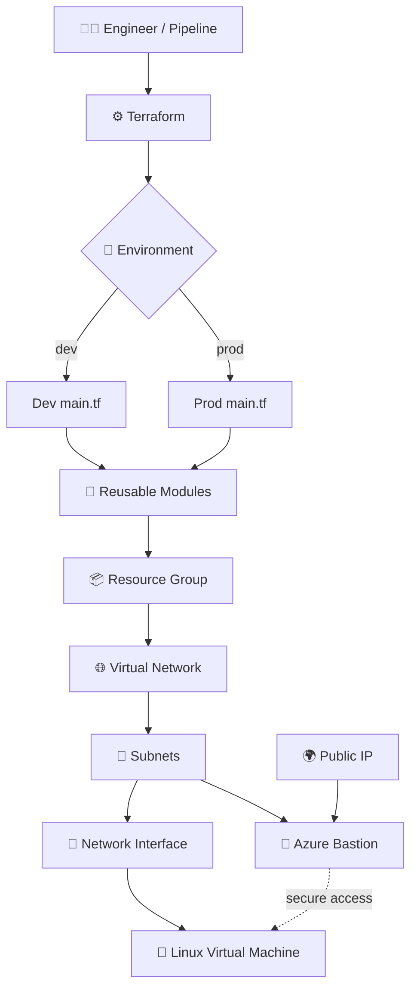
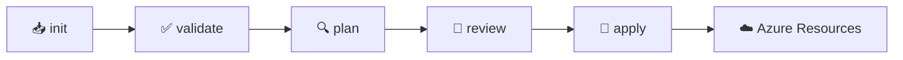

<div align="center">


<a href="https://git.io/typing-svg">
  
</a>

<br/>


</div>

---

## ✨ About the Project

**terraform-azure-modular-infra** is a hands-on Terraform project that builds a complete Azure landing-zone foundation using **reusable modules** and **separate `dev` / `prod` environments**.

Every Azure component (Resource Group, Virtual Network, Subnet, Public IP, Network Interface, Bastion and Linux VM) lives in its own module. The environments simply call these modules with different values, so the same code deploys consistently everywhere.

---

## 🌟 Highlights

| | Feature | Description |
|---|---|---|
| 🧩 | **Reusable Modules** | Each Azure resource is a standalone module with its own `main.tf` and `variable.tf` |
| 🌍 | **Environment Separation** | Independent `dev` and `prod` folders, each with its own provider, variables and values |
| 🛡️ | **Secure VM Access** | VM is reached through **Azure Bastion**, with no public IP on the VM itself |
| 🔁 | **Consistent Deployments** | Same modules, different `terraform.tfvars` per environment |
| 📈 | **Plan before Apply** | Every change is reviewed with `terraform plan` before deployment |

---

## 🧱 Architecture



---

## 📂 Repository Structure

```text
📦 terraform-azure-modular-infra
├── 📁 Environment
│   ├── 📁 dev
│   │   ├── 📄 main.tf
│   │   ├── 📄 provider.tf
│   │   ├── 📄 terraform.tfvars
│   │   └── 📄 variable.tf
│   └── 📁 prod
│       ├── 📄 main.tf
│       ├── 📄 provider.tf
│       ├── 📄 terraform.tfvars
│       └── 📄 variable.tf
└── 📁 Module
    ├── 📁 Azurerm_Bastion
    │   ├── 📄 main.tf
    │   └── 📄 variable.tf
    ├── 📁 Azurerm_Network_interface
    │   ├── 📄 main.tf
    │   └── 📄 variable.tf
    ├── 📁 Azurerm_Pip
    │   ├── 📄 main.tf
    │   └── 📄 variable.tf
    ├── 📁 Azurerm_Resource_Group
    │   ├── 📄 main.tf
    │   └── 📄 variable.tf
    ├── 📁 Azurerm_Subnet
    │   ├── 📄 main.tf
    │   └── 📄 variable.tf
    ├── 📁 Azurerm_Virtual_Network
    │   ├── 📄 main.tf
    │   └── 📄 variable.tf
    └── 📁 Azurerm_Virtual_Machine
        ├── 📄 main.tf
        └── 📄 variable.tf
```

---

## 🧰 Azure Resources Created

| # | Module | Resource | Purpose |
|---|--------|----------|---------|
| 1 | 📦 `Azurerm_Resource_Group` | Resource Group | Logical container that holds all resources of an environment |
| 2 | 🌐 `Azurerm_Virtual_Network` | Virtual Network (VNet) | Private network boundary for all workloads |
| 3 | 🧭 `Azurerm_Subnet` | Subnets | Segments the VNet, including `AzureBastionSubnet` for Bastion |
| 4 | 🌍 `Azurerm_Pip` | Public IP | Static public IP used by the Bastion host |
| 5 | 🔌 `Azurerm_Network_interface` | Network Interface (NIC) | Connects the Linux VM to its subnet |
| 6 | 🌉 `Azurerm_Bastion` | Azure Bastion | Browser-based SSH access to the VM without exposing it publicly |
| 7 | 🐧 `Azurerm_Virtual_Machine` | Linux Virtual Machine | The compute workload running inside the VNet |

---

## 🧩 Module Details

<details>
<summary><b>📦 Azurerm_Resource_Group</b></summary>

Creates the Resource Group in the chosen region. All other modules deploy into it, so it is always created first.

</details>

<details>
<summary><b>🌐 Azurerm_Virtual_Network</b></summary>

Creates the VNet with its address space. Name, location and address range come from variables.

</details>

<details>
<summary><b>🧭 Azurerm_Subnet</b></summary>

Creates the subnets inside the VNet, including the dedicated `AzureBastionSubnet` that Azure Bastion requires.

</details>

<details>
<summary><b>🌍 Azurerm_Pip</b></summary>

Creates the Public IP address attached to the Bastion host. The VM itself does not get a public IP.

</details>

<details>
<summary><b>🔌 Azurerm_Network_interface</b></summary>

Creates the NIC and attaches it to the VM subnet. The Linux VM uses this NIC for all network traffic.

</details>

<details>
<summary><b>🌉 Azurerm_Bastion</b></summary>

Creates the Azure Bastion host using the Public IP and `AzureBastionSubnet`, giving secure RDP/SSH access to VMs.

</details>

<details>
<summary><b>🐧 Azurerm_Virtual_Machine</b></summary>

Creates the Linux Virtual Machine and attaches the NIC. VM size, image and admin settings are driven by variables.

</details>

---

## 🌍 Environments

| Environment | Path | Purpose |
|-------------|------|---------|
| 🟢 **dev** | `Environment/dev` | Testing and experimenting safely |
| 🔴 **prod** | `Environment/prod` | Production-grade deployment |

Each environment contains:

- `main.tf` : calls the modules
- `provider.tf` : Azure provider and backend configuration
- `variable.tf` : input variable declarations
- `terraform.tfvars` : environment-specific values

---

## 🚀 Quick Start

### 1️⃣ Prerequisites

- An Azure subscription with permission to create resources
- [Terraform CLI](https://developer.hashicorp.com/terraform/downloads) installed
- [Azure CLI](https://learn.microsoft.com/cli/azure/install-azure-cli) installed

### 2️⃣ Sign in to Azure

```bash
az login
az account show
```

### 3️⃣ Initialize the environment

```bash
cd Environment/dev
terraform init
```

### 4️⃣ Format and validate

```bash
terraform fmt -recursive
terraform validate
```

### 5️⃣ Preview the changes

```bash
terraform plan
```

### 6️⃣ Deploy

```bash
terraform apply
```

> 🚦 Always review the plan before applying. Check resource names, region, VM size and subnet ranges.

---

## 🔁 Workflow



---

## 🔐 Security Best Practices

- ✅ Never hardcode passwords or secrets in `.tf` or `.tfvars` files
- 🔒 Use **Azure Bastion**, so the VM has no public IP
- 🗃️ Use a **remote backend** (Azure Storage) with encryption and state locking
- 🚫 Never commit `.tfstate`, plan files or secret-containing `.tfvars`
- 🛡️ Open only the network ports that are actually required
- 👤 Follow least-privilege access for the service principal

---

## 🧹 Clean Up

Preview what will be removed:

```bash
terraform plan -destroy
```

Destroy after confirmation:

```bash
terraform destroy
```

> ⚠️ `terraform destroy` deletes real resources. Never run it on production without approval.

---

## 🎯 What This Project Demonstrates

- 🧩 Modular Terraform design with reusable modules
- 🌍 Dev / Prod environment separation
- 🌐 Azure networking: VNet, Subnet, Public IP and NIC
- 🌉 Secure VM access using Azure Bastion
- 🐧 Linux VM provisioning
- 🔎 `validate` and `plan` based change review

---

<div align="center">

### 💙 Built with Terraform + Microsoft Azure

**Infrastructure as Code • Reusable Modules • Secure by Design**


</div>
